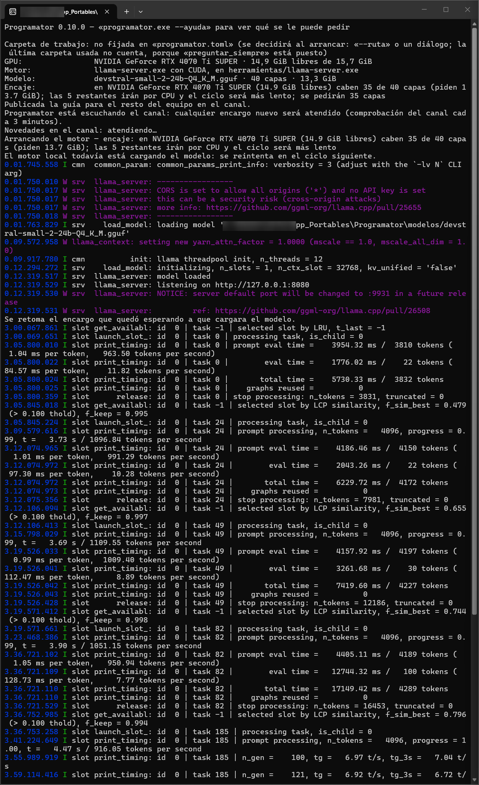
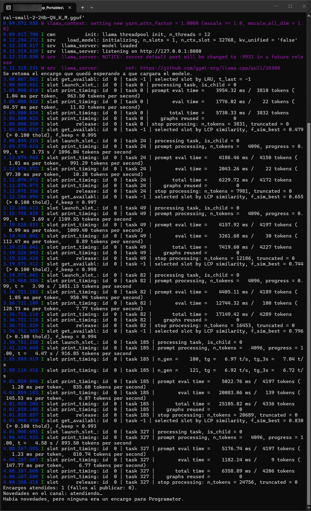

Programator

Programator es una aplicación portable escrita en Rust para Windows y Linux que convierte un modelo de inteligencia artificial local, ejecutándose en la tarjeta gráfica del propio equipo, en un colaborador activo dentro del equipo de trabajo.

El agente se integra en el flujo del proyecto recibiendo encargos de desarrollo y entregando propuestas de código mediante el intercambio de archivos de texto en un canal compartido, sin enviar datos a servicios externos y con total independencia de conexiones remotas para la inferencia.

Esta versión está optimizada para trabajar dentro de Gestor Agentes, una aplicación libre que prepara el proyecto y abre Programator con un clic. Más abajo se explica qué es y dónde se consigue.

Principio rector de diseño

Todo el código y la arquitectura de Programator responden a una premisa de seguridad estricta: el modelo de lenguaje nunca escribe directamente en el proyecto.

El modelo no tiene permisos de edición sobre los archivos de trabajo ni acceso directo al sistema operativo. Para cualquier operación, solicita una acción formal a través de las herramientas proporcionadas por el arnés, y es este quien evalúa y concede o deniega cada petición de forma controlada. Las propuestas de código se escriben de manera aislada en un directorio de candidatos para que otro agente o un revisor humano las inspeccione, valide y traslade al código fuente definitivo.

Para qué sirve

Programator tiene sentido cuando trabajas con un modelo de pago y quieres que la parte más mecánica del trabajo la haga otro. Esa es la idea de la que nace, y de ahí salen cuatro usos que se han dado de verdad, no imaginados.

El primero es quitarle trabajo al modelo de pago. Hay tareas que un modelo local hace con garantías: auditar un fichero cargado de números sueltos y métodos largos, escribir una función acotada cuando le das los requisitos en una lista, traducir código siguiendo un patrón que ya existe. Encargarle eso libera cuota del modelo caro para lo que de verdad la necesita. Pero el ahorro de cuota no es lo que más se nota: lo que más se nota es que trabaja en paralelo. Mientras el modelo local dedica sus dos o tres minutos a una auditoría, quien lo dirige sigue con lo suyo. Al final de una jornada eso son varias tareas hechas que no han costado ni una espera.

El segundo es medir al propio modelo local. Un modelo no es bueno o malo en abstracto: es bueno en unas tareas y malo en otras, y la única forma de saber en cuáles es probarlo con encargos reales y verificar lo que entrega. Programator sirve para eso, y no es una suposición: la carpeta evaluacion de este repositorio contiene la evaluación hecha a mano el 22/09/2026, con el plan y la rúbrica de sus diez encargos, dos scripts de barrido que traen su encargo escrito dentro, semilla fija para que los resultados no dependan del azar, y la configuración exacta que se usó. De ahí salieron las cifras que hoy usamos para decidir qué encargarle. Desde la versión 0.12.0 esa medida la hace el propio Programator con su banco de modelos, que está en evaluacion/banco: quince encargos fijos que se pasan a cualquier modelo con varias semillas y se puntúan siempre de la misma manera. Ese mismo banco sirve para lo otro que hay que medir, que es la configuración: temperatura, tamaño de contexto, cuántas capas caben en la tarjeta. Cambiar un parámetro y ver qué pasa deja de ser intuición y pasa a ser una medida.

El tercero es que tu código no sale de tu máquina. La inferencia ocurre entera en tu propia tarjeta gráfica: el modelo local lee tus ficheros, escribe sus propuestas y no manda una sola línea a ningún servicio. Para trabajo bajo acuerdo de confidencialidad, o simplemente si prefieres que tu código no viaje, eso puede ser la diferencia entre poder usar una herramienta así o no poder.

Conviene aclarar qué significa exactamente, porque es fácil entenderlo de más. Que la inferencia sea local no quiere decir que puedas trabajar sin conexión. Programator no tiene una consola donde tú escribas: recibe los encargos leyendo ficheros de texto del canal, y quien normalmente los escribe es otro agente, que sí es un modelo de pago y sí necesita internet. Así que en el uso habitual hace falta conexión, igual que antes.

Lo que se queda en casa es tu código y lo que el modelo local hace con él, que no es poco. Y si alguna vez quisieras prescindir del agente que dirige, nada impide que escribas tú mismo el encargo a mano en el buzón del canal con un editor de texto, porque el arnés solo busca un encabezado dentro de un fichero. Pero eso no está documentado ni se ha probado, así que no lo cuentes como una forma de trabajo probada: es una posibilidad, no una promesa.

El cuarto es probar otros modelos. Programator no está casado con el modelo con el que se ha desarrollado. Si quieres saber qué te daría otro modelo local, puedes cambiarlo en la configuración y pasarle el mismo banco de pruebas, con los mismos encargos y la misma semilla, y comparar resultados que significan algo porque las condiciones fueron idénticas. Visto así, esto es también un banco de pruebas para decidir con qué modelo quedarse.

Para qué no sirve

Contar solo lo que hace bien sería venderlo por encima de lo que da, así que aquí va la otra mitad. Todo lo que sigue está medido en una prueba de uso real, con catorce encargos sobre un proyecto de verdad, todos verificados contra el código.

No le pidas que diagnostique la causa de un fallo. Es lo que peor hace con diferencia: en la prueba real acertó cero de doce, y las doce explicaciones sonaban plausibles. Si necesitas saber por qué algo se comporta como se comporta, mide tú; un modelo local no sustituye una medición.

No le preguntes por bibliotecas, versiones ni parámetros de una interfaz de programación. Se las inventa, y lo hace justo donde más daño causa: no en las preguntas raras, sino en las razonables, donde lo inventado suena a algo que debería existir. Además no puede comprobarlo, porque no navega ni consulta documentación.

No le des un fichero que crees limpio para que te lo confirme. Ante un fichero cuidado no dice «no veo nada»: rellena con hallazgos inventados. Su acierto sube cuando el fichero de verdad tiene defectos, y se desploma cuando no los tiene.

No esperes que apruebe, firme ni acepte nada. No es una limitación temporal, es el principio de diseño: el modelo no dispone de ese verbo y no va a disponer de él.

Y verifica siempre lo que entregue. No por desconfianza, sino porque verificarlo es barato y equivocarse no lo es.

Cómo se ve

Programator no tiene ventanas: es una terminal que cuenta lo que está haciendo. Estas dos capturas son de una sesión de trabajo de verdad. Lo único que se ha tocado en ellas es el nombre de usuario, tapado en la barra de título y en una ruta del registro del motor; todo lo demás es lo que salió.

Arriba del todo está el informe de arranque, que es lo que escribe antes de hacer nada: qué carpeta de trabajo va a usar y de dónde ha salido esa decisión, qué tarjeta gráfica ha encontrado con cuánta memoria libre, qué motor y qué modelo tiene configurados, y cuántas capas del modelo caben en la tarjeta. Esa última línea es la que evita la mitad de los disgustos: si dice que caben 35 de 40, ya sabes antes de empezar que cinco van a ir por el procesador y que el ciclo será más lento.

Debajo avisa de que ha publicado la guía para el resto del equipo en el canal y de cada cuánto va a mirar si hay encargos nuevos. A partir de ahí lo que se ve es el motor cargando el modelo, con su propio registro intercalado. Fíjate en la línea que dice que el motor todavía está cargando y que se reintentará en el ciclo siguiente: el arnés no se queda colgado esperando ni da el encargo por perdido.

Aquí el modelo ya está cargado y se ve el ciclo trabajando. Cada bloque es una llamada a una herramienta: el modelo pide leer un fichero o buscar algo, el arnés se lo concede o se lo deniega, y vuelve a preguntar. Al final de todo, la línea que cuenta cuántos encargos se han atendido y cuántos fallaron al publicarse, y luego la vuelta a la espera. La última línea dice que había novedades en el canal pero que ninguna era un encargo para él, que es exactamente el tipo de cosa que un arnés callado te haría diagnosticar mal.

Programator y Gestor Agentes

Programator está optimizado para usarse con Gestor Agentes, y es la forma más cómoda de ponerlo a trabajar.

Gestor Agentes es una aplicación de escritorio para Windows y Linux, también portable y también libre. Guarda la lista de tus proyectos de programación y los abre, con un clic, con un agente de inteligencia artificial: Claude Code, Codex, Gemini a través de agy, o Programator. Cada agente se abre en su propia ventana de terminal, ya situado en la carpeta del proyecto. Antes de abrirlo, la aplicación deja el proyecto preparado para el trabajo en común: escribe las instrucciones que leen todos los agentes, crea el repositorio git si falta y prepara la carpeta .gestor, donde los agentes se dejan mensajes y llevan su diario.

Esa carpeta es justo la que usa Programator. Su canal es .gestor/canal, su buzón es el fichero .gestor/canal/programator.md y sus propuestas van a .gestor/candidatos/programator. En un proyecto abierto con Gestor Agentes, Programator encuentra el canal en su sitio y no hay que configurar nada más. Los demás agentes tienen preparada la guía para encargarle trabajo, que Programator publica en el canal al arrancar, y saben cuándo leerla. Gestor Agentes añade además su propio sistema de reglas: el reparto de papeles, la verificación por otro agente, las reservas de archivos y tu aprobación antes de publicar nada. Así el trabajo que entrega Programator pasa siempre por la revisión de otro agente antes de entrar en el proyecto, que es justo lo que este documento recomienda más arriba.

Programator funciona también sin Gestor Agentes. Basta con un proyecto que tenga la carpeta .gestor/canal y con otro agente, o contigo, que deje los encargos en su buzón. Pero todo eso lo tendrías que montar a mano.

Gestor Agentes se consigue en su repositorio de GitHub, https://github.com/celtidcs/gestor-agentes, y el paquete portable de cada sistema está en su página de versiones publicadas, https://github.com/celtidcs/gestor-agentes/releases. Se descomprime donde quieras y se abre, sin instalar nada. Se publica con la misma licencia que Programator, la GPL-3.0 o posterior.

Sobre el equipo en el que se ha probado

Conviene que sepas en qué máquina se ha desarrollado y medido todo esto, porque las cifras de arriba salen de ahí y en otro equipo pueden ser distintas.

La tarjeta gráfica es una NVIDIA GeForce RTX 4070 Ti SUPER con 16 GiB de memoria, de los que el sistema ve 16.376 MiB. El modelo local es devstral-small-2-24b-Q4_K_M.gguf, de 40 capas y 13,3 GiB. El motor de inferencia es llama-server, compilación b10993 con CUDA 12.4. La ventana de contexto por defecto son 16.384 tokens.

Con esa configuración y el margen de seguridad de 1 GiB que se usaba entonces, Programator colocaba 39 de las 40 capas del modelo en la tarjeta, lo que daba unos 18,4 tokens por segundo (medido el 22/09/2026). Desde el 12/11/2026 Programator mide la memoria de toda la tarjeta, que antes salía exagerada en alrededor de 1 GiB, y el margen por defecto bajó a 512 MiB. Forzando las 40 capas la generación sube a 23,0 tokens por segundo, pero entonces el proceso ocupa 15.851 de los 16.376 MiB disponibles y el margen se vuelve muy estrecho. Por eso el valor por defecto deja siempre un margen.

En cuanto a Linux, Programator nació en Windows y ahí es donde está probado contra hardware real. Desde la versión 0.10.0 también funciona en Linux: la suite entera se ha ejecutado dentro de un Linux de verdad, con formato verificado, clippy sin avisos y todas las pruebas en verde, y la integración continua lo repite en los dos sistemas en cada cambio. Lo que todavía no ha hecho nadie es arrancarlo en un Linux con una tarjeta gráfica delante, así que la medición de la tarjeta y la carga del modelo están sin verificar ahí. Lo que puede fallar, y cómo sortearlo, está contado en el documento de defectos conocidos, docs/defectos-conocidos.md.

Nada de esto significa que la aplicación solo funcione ahí. Programator mide la tarjeta que encuentre, pesa el modelo que le indiques y calcula cuántas capas caben, así que se adapta a otro equipo sin que tengas que tocar nada. Lo que sí cambia con el hardware es el rendimiento, y si tu tarjeta tiene menos memoria es posible que tengas que usar un modelo más pequeño. Las cifras de esta sección son un punto de referencia de un equipo concreto, no una promesa sobre el tuyo.

Puesta en marcha

La puesta en marcha detallada se explica en la guía del paquete portable, plantillas/LEEME-portable.md. Allí encontrarás los tres pasos para iniciar el arnés, la preparación de dependencias locales (el ejecutable llama-server con soporte CUDA y el archivo GGUF del modelo) y la resolución de incidencias frecuentes en el arranque.

Compilación y verificación mecánica

El proyecto se rige por un criterio de verificación estricto: ninguna entrega se acepta sin la superación limpia e independiente de tres comprobaciones mecánicas, que son estas tres órdenes:

    cargo test
    cargo clippy --all-targets -- -D warnings
    cargo fmt --check

Las tres deben ejecutarse sin fallos, sin advertencias y sin diferencias de formato.

Estructura del código fuente

El código fuente, en la carpeta src, se organiza en módulos con responsabilidades aisladas.

El fichero src/main.rs es el punto de entrada del programa: inicia el bucle principal de sondeo y gestiona las paradas, y src/argumentos.rs interpreta la línea de órdenes. Los ficheros src/config.rs y la carpeta src/config cargan el archivo de configuración TOML, lo validan y dan los valores por defecto. El fichero src/carpeta.rs resuelve, valida y recuerda la carpeta de trabajo del proyecto.

La carpeta src/protocolo implementa el canal de comunicación basado en archivos: la lectura de los buzones, la emisión del latido, la gestión del estado y las propuestas de poda. La carpeta src/motor se ocupa de llama-server: controla el ciclo de vida del proceso de inferencia, evalúa la salud del servidor, lee el fichero GGUF del modelo y calcula cuántas capas caben en la tarjeta gráfica.

La carpeta src/arnes contiene la lógica central del sistema, que incluye la ficha del repertorio, la composición de las instrucciones, el ciclo de inferencia, el confinamiento de lo que el modelo puede tocar, el colapso de repeticiones y la verificación de la sintaxis de lo que se entrega. La carpeta src/arranque reúne las funciones de inicio de sesión, la publicación de las guías de trabajo, la instalación de normas y los avisos de disponibilidad en la consola.

La carpeta src/banco es el banco de modelos: pasa los encargos fijos por el ciclo real, ejecuta las pruebas ocultas aisladas, recoge las rúbricas, puntúa y escribe el informe. La carpeta src/registro guarda lo que el banco midió de cada modelo, y src/revision hace la revisión de modelos: busca candidatos en Hugging Face, los descarga, les pasa el banco, propone cuáles se quedan y retira los que sobran.

Los ficheros src/diagnostico.rs y src/informe.rs miden la máquina al arrancar y cuentan lo que han medido. El fichero src/actualizacion.rs avisa de si hay una versión más nueva en GitHub, sin descargar nada nunca. Los ficheros src/aislamiento_windows.rs y src/ayudante_aislado.rs aíslan en Windows las pruebas ocultas, con integridad baja y un Job Object. El fichero src/orden_acotada.rs ejecuta órdenes con un tiempo máximo y sin pasar por una shell, y src/ficheros.rs lee y escribe ficheros con errores que nombran la ruta.

Guía de la documentación

La carpeta docs contiene lo que hace falta saber para usar el programa y para seguir trabajando en él.

El Manual de uso explica qué es Programator, para qué sirve y cómo se pone en marcha, pensado para quien lo abre por primera vez. La guía Instalación paso a paso, en docs/instalacion-paso-a-paso.md, cuenta qué descarga el script de instalación, de dónde lo saca, cómo comprueba que es lo que debía ser, y qué hacer a mano si alguna de esas descargas falla o deja de estar disponible. La guía Como adaptar el banco de modelos explica cómo cambiar los lenguajes y los encargos del banco de pruebas.

El documento de defectos conocidos, docs/defectos-conocidos.md, es de obligada consulta: detalla las limitaciones vigentes, las pruebas que requieren hardware real y los aspectos estructurales pospuestos. El de pruebas manuales, docs/pruebas-manuales.md, recoge los procedimientos de verificación sobre tarjeta gráfica y modelo real. Ninguna prueba automática enciende la tarjeta, así que esa es la única comprobación de la junta entre el arnés y el motor.

Sobre Celtilander

Soy un usuario novel en el mundo de la programación y la IA. He «ayudado a crear» esta app y espero
que a alguien le pueda servir para algo... sin más.

Lo que no funciona no lo escondo: está escrito en defectos conocidos. Si encuentras algo que no esté
ahí, cuéntamelo.

Para realizar esta app he montado un sistema colaborativo y de consenso entre ChatGPT Codex, Claude
Code y Gemini Antigravity. Yo puse la idea y dirigía el proyecto, mientras que ellos diseñaban,
repartían y verificaban el trabajo. Ningún código fue revisado por el agente que lo había escrito, y
una vez terminado todo debía ser aprobado por unanimidad. Hasta que no se conseguía el consenso, no
se daba una tarea por concluida. Cuando por algún motivo no se llegaba a un consenso, era yo quien
tomaba la decisión final, así que los fallos que pueda haber serán más míos que de ellos.

Saludos a todo el mundo.

Licencia

Programator se publica con la licencia GPL-3.0 o posterior. El texto íntegro está en el archivo LICENSE.

En corto: puedes usar el programa para lo que quieras, estudiar cómo funciona por dentro, modificarlo y repartirlo. La única condición es que, si repartes una versión modificada, publiques también su código, con esta misma licencia.

Se eligió copyleft y no una licencia permisiva a propósito, y el motivo es el mismo principio que gobierna el código. Programator existe para que una persona conserve el control sobre lo que hace un modelo: por eso el modelo pide permiso y el arnés concede o deniega, en lugar de escribir por su cuenta. Una herramienta que defiende esa idea no debería poder cerrarse y venderse sin devolver nada. Lo que se construya encima vuelve a todos.
